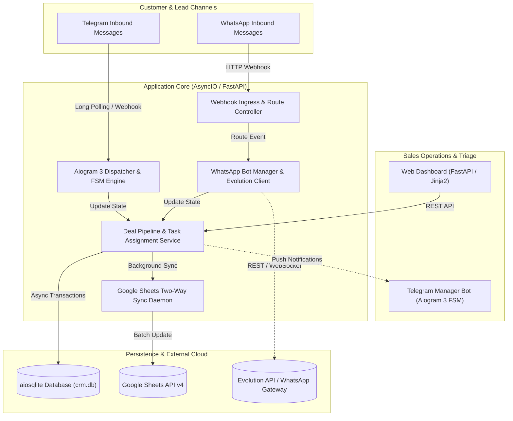

# Omnichannel CRM & Lead Automation Platform

> **Asynchronous, omnichannel CRM and automated lead-routing engine architected with a high-concurrency FastAPI core, Aiogram 3 Telegram bot, WhatsApp Business webhook gateway, and bidirectional Google Sheets synchronization.**

[](https://www.python.org/)
[](https://fastapi.tiangolo.com/)
[](https://aiogram.dev/)
[](https://github.com/omnilib/aiosqlite)
[](https://whatsapp.com)
[](https://developers.google.com/sheets/api)
[](https://www.docker.com/)

---

## Pitch & Executive Summary

**Omnichannel CRM** is an event-driven customer relationship and sales pipeline platform designed to bridge the gap between instant messaging customer interactions and enterprise sales workflows. By uniting **Telegram** and **WhatsApp Business** conversational channels into a unified asynchronous **FastAPI** hub, the platform captures, qualifies, and routes leads in real-time while maintaining bidirectional data synchronization with **Google Sheets** for non-technical stakeholders.

The architecture eliminates response latency through non-blocking I/O routines, providing sales managers with automated task alerts, interactive bot commands, and a web dashboard for pipeline triage.

---

## Architecture Overview

The system operates as an asynchronous coordination gateway, aggregating incoming chat webhooks, dispatching tasks to sales agents, and persisting state across relational tables and cloud spreadsheets:



### Architectural Highlights

- **Unified Omnichannel Ingress:** Normalizes message schemas from disparate transports (Telegram Bot API, WhatsApp Web / Evolution API webhooks) into a single canonical `Lead` / `Deal` domain model.
- **Asynchronous Finite State Machine (FSM):** Powers conversational qualification flows via **Aiogram 3.3**, guiding potential buyers through automated questionnaires before escalating to human managers.
- **Non-Blocking Persistence Layer:** Built with **aiosqlite**, providing asynchronous, thread-safe database operations that guarantee responsive webhook processing without blocking the event loop.
- **Two-Way Cloud Spreadsheet Mirroring:** Decoupled sync service reading and writing directly to Google Sheets API v4, including offline mock fallbacks for isolated testing environments.

---

## Key Enterprise Features

### 1. Dual-Channel Instant Messaging Integration
- **Telegram Business Bot (Aiogram 3):** Full customer lifecycle handling—greetings, product catalogs, FAQ resolution, deal creation, and manager notifications with inline interactive buttons.
- **WhatsApp Webhook Gateway:** Direct integration with Evolution API / WhatsApp-Web.js, supporting QR code authentication, automatic inbound lead capture, and instant templated auto-replies.

### 2. High-Throughput Asynchronous Web Dashboard
- Lightweight, responsive web interface powered by **FastAPI** and **Jinja2** templates.
- Real-time pipeline triage: stage transitions (`New` $\rightarrow$ `Negotiation` $\rightarrow$ `Contract` $\rightarrow$ `Closed Won` / `Lost`), deal volume metrics, and deadline tracking for pending tasks.

### 3. Bidirectional Google Sheets Synchronization
- Real-time streaming of new leads and deals into designated Google Sheet columns.
- Automatic header verification, OAuth2 credential caching, and batch updates to prevent hitting Google API quotas.

### 4. Automated Manager Delegation & Alerting
- Push notification engine alerting sales representatives via Telegram whenever a new lead arrives or a deadline expires.
- Task scheduler tracking pending client follow-ups with automated reminder triggers.

---

## Tech Stack & Architectural Rationale

| Layer | Technology | Architectural Rationale |
| :--- | :--- | :--- |
| **Backend & Web Core** | **FastAPI 0.104+** | Asynchronous ASGI framework delivering high throughput for external webhook endpoints and lightning-fast internal REST operations. |
| **Telegram Engine** | **Aiogram 3.3** | Async-native Telegram framework featuring structured routers, middlewares, and memory/Redis-backed FSM state handling. |
| **WhatsApp Protocol** | **Evolution API / WhatsApp-Web.js** | Decoupled WhatsApp gateway bridging Baileys protocol to standard HTTP webhooks without vendor lock-in. |
| **Persistence** | **aiosqlite 0.19+** | Non-blocking SQLite driver enabling ACID compliance and sub-millisecond local reads with zero infrastructure overhead. |
| **External Integration** | **Google API Client v4** | Industry-standard SDK with OAuth2 service account authorization for automated corporate spreadsheet replication. |
| **Templating & UI** | **Jinja2 & HTML5/Tailwind** | Server-Side Rendered (SSR) management views ensuring zero JavaScript build-step complexity and instantaneous loading. |
| **Containerization** | **Docker Compose** | Multi-container configuration managing Evolution API instances and persistent session volumes. |

---

## Repository Structure

```text
├── bot.py                       # Aiogram 3 Telegram bot router, handlers and FSM states
├── web.py                       # FastAPI application, route handlers and template controllers
├── database.py                  # Async SQLite repository layer (deals, clients, tasks)
├── main.py                      # Multi-threaded orchestrator (runs Bot + Web concurrently)
├── whatsapp_integration.py      # WhatsApp bot manager and webhook route bindings
├── whatsapp_service.js          # Node.js Baileys/WhatsApp-Web client daemon
├── google_sheets.py             # Google Sheets API v4 two-way sync engine & mock fallback
├── docker-compose.evolution.yml # Evolution API container definition
├── templates/                   # Jinja2 HTML templates for the web management console
├── requirements.txt             # Pinned Python dependencies
├── package.json                 # WhatsApp Node.js dependencies
└── README.md                    # System architecture and deployment guide
```

---

## Getting Started

### Prerequisites

- **Python 3.10+**
- **Node.js 18+** (Optional, for native WhatsApp client)
- **Docker & Docker Compose** (Optional, for containerized Evolution API)
- Telegram Bot Token from [@BotFather](https://t.me/BotFather)

---

### Step 1: Installation & Setup

1. **Clone repository:**
   ```bash
   git clone https://github.com/NURJAKS/crm-system.git
   cd crm-system
   ```

2. **Configure virtual environment:**
   ```bash
   python3 -m venv venv
   source venv/bin/activate
   pip install -r requirements.txt
   ```

3. **Configure Environment Variables:**
   ```bash
   cp env.example .env
   ```
   Edit `.env` with your credentials:
   ```env
   BOT_TOKEN=123456789:ABCdefGHIjklMNOpqrSTUvwxYZ
   ADMIN_CHAT_ID=123456789
   DATABASE_URL=crm.db
   PORT=8000
   ```

---

### Step 2: Running the System

You can run individual components or launch the full unified stack:

```bash
# Launch unified stack (Telegram Bot + FastAPI Web Dashboard):
python3 main.py

# Or launch Web Dashboard only:
python3 -c "import main; main.run_web()"

# Or launch Telegram Bot only:
python3 -c "import main; main.run_bot()"
```

Open your browser at **[http://localhost:8000](http://localhost:8000)** to view the live CRM console.

---

### Step 3: Setting Up WhatsApp Integration (Optional)

Run the containerized Evolution API gateway:

```bash
docker compose -f docker-compose.evolution.yml up -d
```
Scan the generated QR code to bind your WhatsApp Business line to the webhook ingress.

---

## Verification & Workflow Test

| Component | Test Action | Expected Result |
| :--- | :--- | :--- |
| **Web Dashboard** | Open `http://localhost:8000` | Real-time statistics, client table, and deal pipeline render without errors |
| **Telegram Bot** | Send `/start` to your bot | Interactive welcome message with lead capture buttons appears |
| **New Lead Flow** | Submit lead through bot/web | New row is automatically added to SQLite DB and synchronized to Google Sheets |

---

## Known Limitations & Production Roadmap

- **PostgreSQL Adapter:** Seamless migration from `aiosqlite` to `asyncpg` / PostgreSQL for multi-instance horizontal scaling.
- **Redis FSM Storage:** Upgrading Aiogram's in-memory FSM storage to Redis for state persistence across process restarts.
- **RBAC for Sales Teams:** Granular manager roles restricting deal visibility to assigned accounts only.

---

## License

This project is licensed under the MIT License.
